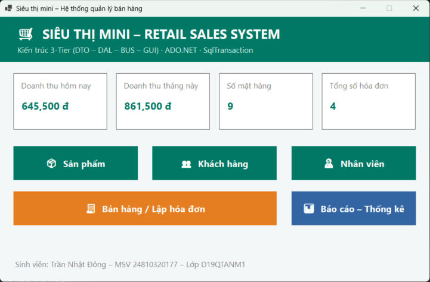
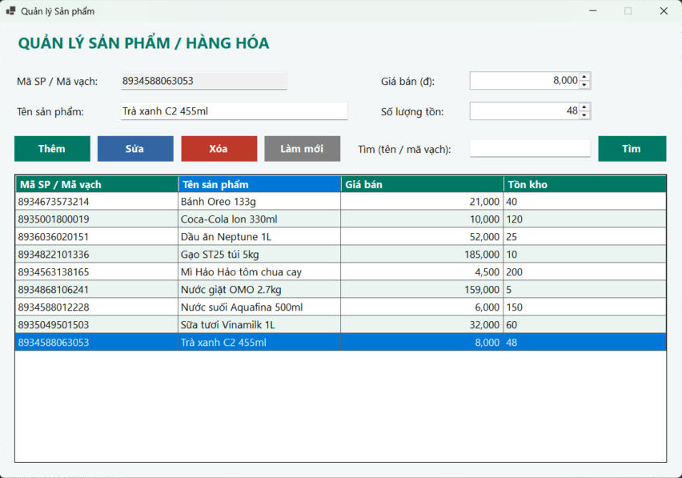
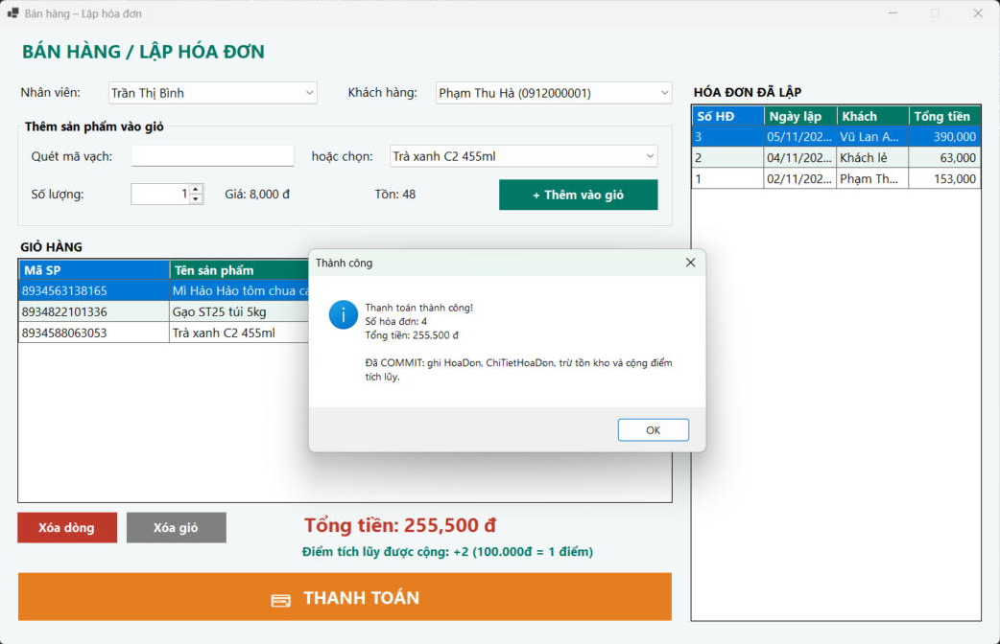
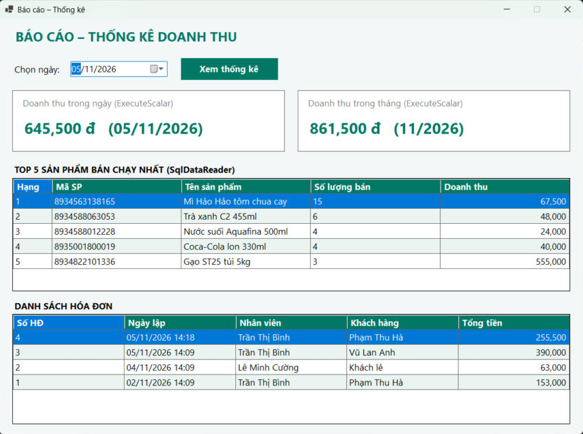
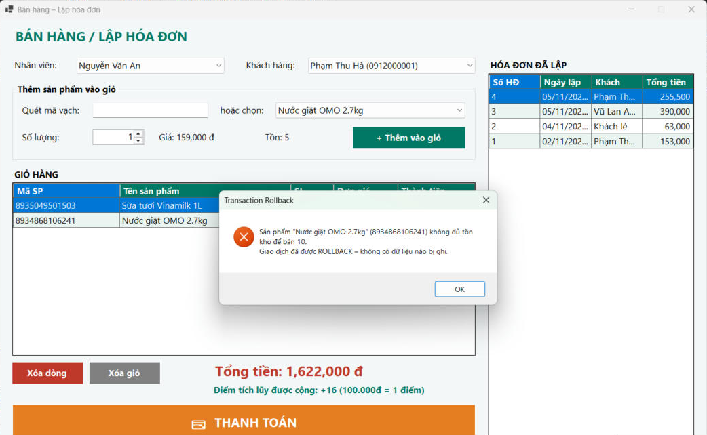
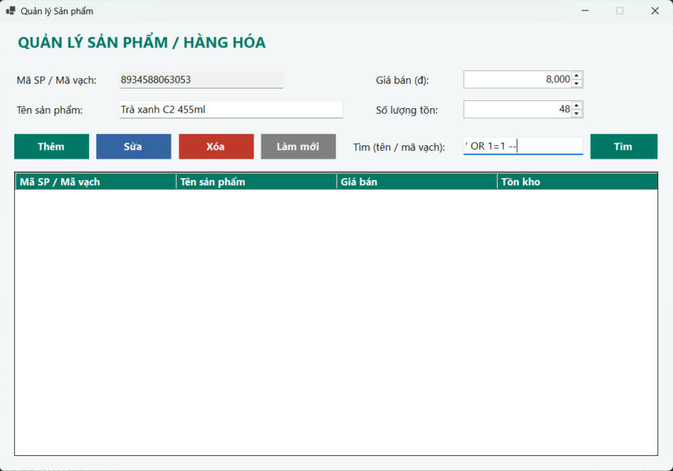

# Bài 6.1 – Hệ thống Quản lý Bán hàng & Siêu thị mini (Retail Sales System)

## MỤC 1: THÔNG TIN SINH VIÊN

- **Họ và tên sinh viên:** Trần Nhật Đông
- **Mã sinh viên:** 24810320177
- **Lớp / Khóa:** D19QTANM1 – Lập trình .NET

## Công nghệ & yêu cầu đã thực hiện

| Yêu cầu đề bài | Cách làm trong project |
|---|---|
| CSDL `SalesDB` 5 bảng có khóa ngoại | `Database/ScriptDB.sql` – NhanVien, KhachHang, SanPham, HoaDon, ChiTietHoaDon (CHECK, UNIQUE, DEFAULT, PK kép `(MaHD, MaSP)`) + dữ liệu mẫu |
| Kiến trúc 3-Tier | `DTO/` – `DAL/` (ADO.NET) – `BUS/` (kiểm tra nghiệp vụ) – `GUI/` (WinForms) |
| Chống SQL Injection 100% | Mọi câu lệnh dùng `SqlParameter` (khai báo kiểu `SqlDbType`), không nối chuỗi SQL |
| CRUD Sản phẩm / Khách hàng / Nhân viên | `FrmSanPham`, `FrmKhachHang`, `FrmNhanVien` |
| Tìm sản phẩm theo tên hoặc mã vạch với `%` | `SanPhamDAL.TimKiem`: `LIKE @tuKhoa`, ký tự `%` nằm trong **giá trị** tham số |
| Lập hóa đơn bắt buộc dùng `SqlTransaction` | `HoaDonDAL.LapHoaDon`: INSERT HoaDon → INSERT ChiTietHoaDon → trừ `SoLuongTon` → cộng `DiemTichLuy` → `Commit()`; thiếu hàng → `trans.Rollback()` |
| Tích điểm `DiemTichLuy += TongTien / 100000` | `KhachHangBUS.TinhDiem` |
| Doanh thu ngày / tháng bằng `ExecuteScalar` | `ThongKeDAL.DoanhThuNgay`, `DoanhThuThang` |
| Top 5 sản phẩm bán chạy bằng `SqlDataReader` | `ThongKeDAL.Top5BanChay` |

Trừ tồn kho dùng câu lệnh có điều kiện để không bao giờ bán âm kho:

```sql
UPDATE SanPham SET SoLuongTon = SoLuongTon - @sl
WHERE MaSP = @sp AND SoLuongTon >= @sl   -- 0 dòng bị ảnh hưởng => Rollback
```

## MỤC 2: HÌNH ẢNH KẾT QUẢ CÁC MÀN HÌNH CHỨC NĂNG

1. **Màn hình Chính / Tổng quan hệ thống** – doanh thu hôm nay, doanh thu tháng, số mặt hàng, số hóa đơn.

   

2. **Màn hình Quản lý Danh mục (CRUD – Thêm/Sửa/Xóa)** – thêm sản phẩm "Trà xanh C2 455ml" rồi sửa giá/tồn kho.

   

3. **Màn hình Thực thi Nghiệp vụ chính (Lập Hóa đơn / Bán hàng)** – quét mã vạch thêm vào giỏ, chọn khách hàng, thanh toán: SqlTransaction COMMIT (hóa đơn số 4, cộng +2 điểm).

   

4. **Màn hình Báo cáo – Thống kê** – doanh thu ngày/tháng (ExecuteScalar), Top 5 bán chạy (SqlDataReader), danh sách hóa đơn.

   

5. **Minh họa An toàn Dữ liệu (Transaction Rollback)** – bán 10 "Nước giặt OMO" trong khi tồn kho chỉ còn 5 → `trans.Rollback()`, cả hóa đơn lẫn dòng "Sữa tươi Vinamilk" cùng giỏ đều không bị ghi.

   

   **Phòng chống SQL Injection** – nhập `' OR 1=1 --` vào ô tìm kiếm: chuỗi được truyền như dữ liệu qua `SqlParameter`, không trả về bản ghi nào.

   

## Cấu trúc thư mục

```
├── Database/
│   └── ScriptDB.sql          # Tạo CSDL SalesDB + dữ liệu mẫu
├── QuanLyBanHang/
│   ├── DTO/                  # SanPhamDTO, KhachHangDTO, NhanVienDTO, HoaDonDTO, ChiTietHoaDonDTO, TopSanPhamDTO
│   ├── DAL/                  # DBConnection, SanPhamDAL, KhachHangDAL, NhanVienDAL, HoaDonDAL (SqlTransaction), ThongKeDAL
│   ├── BUS/                  # SanPhamBUS, KhachHangBUS, NhanVienBUS, HoaDonBUS, ThongKeBUS
│   ├── GUI/                  # FrmMain, FrmSanPham, FrmKhachHang, FrmNhanVien, FrmBanHang, FrmThongKe, UI
│   └── App.config / Program.cs
├── images/                   # Ảnh chụp màn hình
├── README.md
└── QuanLyBanHang.sln
```

## Cách chạy

1. Cần Visual Studio 2022/2026 với .NET 10 và **SQL Server LocalDB** (cài kèm workload ".NET desktop development").
2. Mở `QuanLyBanHang.sln`, nhấn **F5**. NuGet tự tải `Microsoft.Data.SqlClient`.
3. Lần chạy đầu, chương trình tự chạy `Database/ScriptDB.sql` để tạo CSDL `SalesDB` và dữ liệu mẫu (hoặc chạy script thủ công trong SSMS).
4. Dùng SQL Server Express thay vì LocalDB: sửa `Data Source` trong `App.config` (ví dụ `.\SQLEXPRESS`).

Mã vạch mẫu để thử chức năng quét: `8934563138165` (Mì Hảo Hảo), `8934822101336` (Gạo ST25), `8934868106241` (OMO – tồn 5, dùng để thử Rollback).
